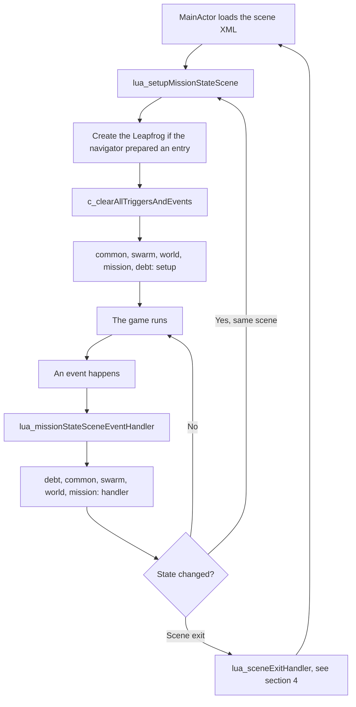
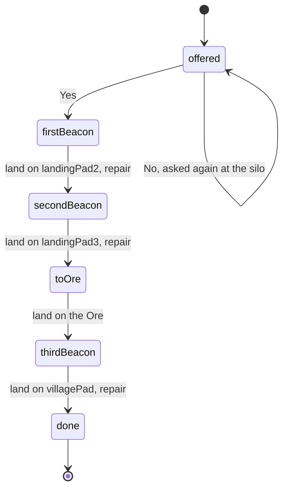
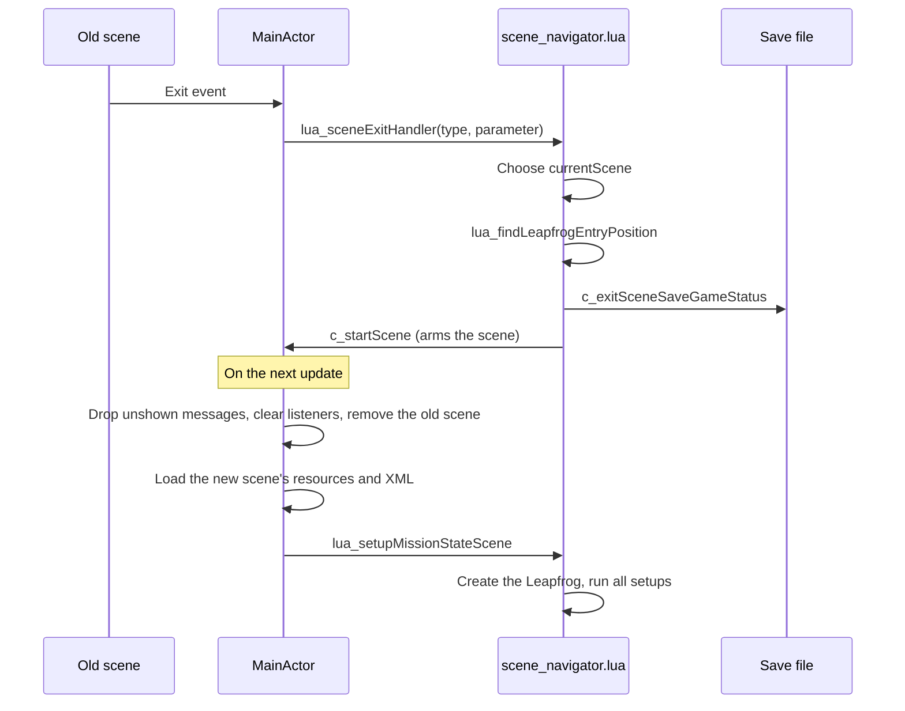

# Leapfrog Lua developer's guide

How the game's story and mission logic is written in Lua: what runs when, how
to build a mission, how events reach your code, and how the game moves between
scenes.

| Section | What it covers |
|---|---|
| [1. How it fits together](#1-how-it-fits-together) | What runs when |
| [2. Worked example](#2-worked-example-the-dark-beacons) | A complete mission, step by step |
| [3. Events and triggers](#3-events-and-triggers) | Listening, property triggers, timers, questions |
| [4. Scene transitions](#4-scene-transitions) | Exits, entry positions, saving, known gaps |
| [5. Recipes](#5-recipes) | Checklists for adding things to the game |
| [6. Testing](#6-testing) | Running and writing mission tester tests |
| [7. Reference](#7-reference) | Every `c_` function, event and object property |

The mission tester (`tests/guide.lua`) checks this file. Code marked as coming
from a file must still be in that file, and the functions, events and test steps
named here must exist.

## 1. How it fits together

The C++ game owns the physics, the scene objects and the display. Lua owns the
story: it decides what a scene contains in the current mission state, and what
happens when something occurs.

| File | Job |
|---|---|
| `src/luainterface.cpp` | Loads the scripts, registers the `c_` functions, passes events to Lua |
| `data/scene_navigator.lua` | Which scene comes next, where the Leapfrog enters, saving at scene exits |
| `data/mission_script.lua` | The master: calls the scripts below, in order, for each setup and event |
| `data/lua/common.lua` | True in every scene: message senders and their colours |
| `data/lua/swarm.lua`, `data/lua/debt.lua`, `data/lua/baxter_ship.lua` | Shared services: stripper swarms, Bruno's credit, the Baxters' ship in the background |
| `data/lua/worlds/mining.lua` | One world's pads, services and repeatable jobs, also in free play |
| `data/lua/mission_<name>.lua` (`mission_beacons.lua`, `mission_package.lua`, `mission_stash.lua`) | One mission's story, in all its scenes |
| `data/lua/test_starts.lua` | The main menu's test row |

### The two entry points

Almost everything you write runs from one of two functions in a mission or
world script:

- **Scene setup** runs when a scene has been loaded, and again whenever a script
  calls `lua_setupMissionStateScene()`. It builds what this state needs.
- **The event handler** runs each time something the scripts listen to happens.
  It decides what the event means, usually by moving to a new state.



Every script gets every event. A world or mission handler must therefore check
`eventId`, `actorName` and, where it matters, `currentScene` and `currentState`.

### Globals you will use

| Global | Meaning |
|---|---|
| `currentScene` | File name of the scene, e.g. `"home_scene.xml"` |
| `currentSceneType` | 0 landing, 1 deep space, 2 orbit, 3 hyperspace |
| `currentMission` | The running mission's name, e.g. `"stash"`; `freePlay` when none runs |
| `currentState` | The mission's state, one number |
| `newGameStarting` | True during the very first setup of a new game |
| `lfDefined` | False until the Leapfrog has been created in this scene |
| `useInitialLfPos` | True when the scripts choose the Leapfrog's start position, false when the navigator's `nextLf...` values apply |

### Rules for all scripts

- Use `listen(actorName, eventId)`, not `c_registerEventHandler`. When two
  scripts want the same event, `listen` registers it once and each handler is
  still called once.
- Only `mission_script.lua` calls `c_clearAllTriggersAndEvents`.
- Declare states in a `State` table and refer to them by name. The number is
  what gets saved, so don't renumber a state that saved games may hold.
- Question ids: missions 1 to 99, worlds 100 to 999, common 1000 and up.
- Don't call a `c_` function at the top level of a script file. The scripts are
  loaded before the `c_` functions are registered, so only code inside functions
  can use them.

## 2. Worked example: the dark beacons

`data/lua/mission_beacons.lua`, the mission `"beacons"`, is a complete small
mission, and `mission_tester/tests/mission_beacons.lua` plays it. Bruno pays the
pilot to relight three dead beacons in the home scene, one at a time: two on the
way to the Ore, where he meets Bruno, and one past the town. A new game starts
here, and it hands over to the mission `"package"` on the last pad. You can also start it from the main menu's
test row: **Beacons, job offered**.

### Step 1: plan the states

Only `currentState` is saved, so anything the player must not lose needs a state
of its own. That's why the beacons are lit in a fixed order: the state alone then
says which ones are lit. If the player could light them in any order, one number
wouldn't be enough without one state per combination.



<!-- verbatim: data/lua/mission_beacons.lua -->
```lua
local State = {
   offered      = 10,  -- Bruno has offered the job
   firstBeacon  = 11,  -- relight the first beacon
   secondBeacon = 12,
   toOre        = 13,  -- two lit, meet Bruno at the Ore
   thirdBeacon  = 14,  -- the one past the town
   done         = 15,
}
mission.State = State
```

### Step 2: create and register the script

A mission file returns a table with `firstState`,
`setupMissionStateScene` and `missionStateSceneEventHandler`. It may also have
`reentryOutcome`, see section 4.

Missions have names, not numbers: `"beacons"`, `"package"`, `"stash"`. The
order of the story is in the missions themselves, each starting the next by name
when it ends (step 6), so reordering touches only those calls. Three places make a
mission known to the game:

1. **`src/luainterface.cpp`**, so that `require` finds it. This is the only C++
   change, and the game has to be rebuilt:

   <!-- verbatim: src/luainterface.cpp -->
   ```cpp
   preloadModule("lua/mission_stash.lua", "mission_stash");
   ```

2. **`data/mission_script.lua`**, in the `missions` table:

   <!-- verbatim: data/mission_script.lua -->
   ```lua
   local missions = {
      beacons = require('mission_beacons'),
      package = require('mission_package'),
      stash   = require('mission_stash'),
   }
   ```

3. **`data/lua/test_starts.lua`**, so that you can start it from the menu:

   <!-- verbatim: data/lua/test_starts.lua -->
   ```lua
   { label = "Beacons, job offered", scene = "home_scene.xml",       sceneType = 0, mission = "beacons", state = B.offered },
   ```

New Lua files in `data/lua` need no project changes. Xcode includes that folder
as a whole, and Android takes all of `data`. A new XML file directly in `data`
must be added to both Xcode projects.

### Step 3: write the scene setup

Setup is called for every scene the mission passes through, and again at each
state change. It must rebuild the scene from `currentState` alone, because
objects return to their XML values whenever a scene loads. Lit beacons are only
active because this code says so:

<!-- verbatim: data/lua/mission_beacons.lua -->
```lua
local function setupBeacons()
   for i, beacon in ipairs(mining.beacons) do
      local isNext = currentState == beaconStates[i]

      if currentState > beaconStates[i] then
         mining.lightBeacon(beacon)
      else
         mining.darkenBeacon(beacon, isNext)
      end

      if isNext then
         beaconTrigger = c_registerPropertyTrigger(beacon.pad, lfLanded, "insideRange", 1, 1)
         listen(beacon.pad, "OpTr")
      end
   end
end
```

An inactive pad sends no `LpLL`, so the mission can't listen for a landing in the
usual way. It watches the pad's `lfLanded` property instead, which changes
whether the pad is active or not.

The beacons themselves are in the world script, `lua/worlds/mining.lua`, because they
stay lit after the mission: `mining.beacons` lists them, and `mining.lightBeacon` and
`mining.darkenBeacon` set the pad, the map and the lamp. The lamps are sprites in the
scene, and `c_animateSprite` runs them: a dark beacon is stopped on its off frame, and
a lit one blinks. Like everything else here, this must be done in setup, because a
scene load starts over from the XML. Once the player holds `villagePadSolution`, the
world's setup lights all of them itself and fills their pads with free fuel again.

The mission's setup function starts by leaving every scene but its own:

<!-- verbatim: data/lua/mission_beacons.lua -->
```lua
mission.setupMissionStateScene = function()

   if currentScene ~= "home_scene.xml" then
      return
   end

   repairingPad = nil
   repairTimer = -1
   setupBeacons()

   -- Launching is the world's job; without the launch site on the map
   -- nothing leads there yet
   c_setObjectMapShown("launchSite1", "mainTank", false)

   if currentState == State.offered then
      listen("siloLandingPad", "LpLL")
      listen("oreLanding", "LpLL")
      offerPending = false

      if newGameStarting then
         -- The mining world script has put the leapfrog above the silo
         startFuel = c_getObjectProperty("leapfrog1", fuelProperty)
         playBrunoCall()
      else
         c_addDialogMessage("The old beacons have gone dark. I pay to have them lit.", "Bruno", true, 60, 0)
         c_askQuestion(Question.takeJob, "Do you want the job?", "Bruno", "Touch down and let's talk.")
         offerPending = true
      end

   elseif currentState == State.toOre then
      listen("oreLanding", "LpLL")
      c_setObjectMapState("oreLanding", "noName", 2)
      reminderTimer = c_startSceneTimer(reminderTicks)

   elseif currentState == State.firstBeacon or currentState == State.secondBeacon then
      -- Not there yet
      listen("oreLanding", "LpLL")
   end
end
```

A mission doesn't need to handle the launch site. Nothing launches until a script
reacts to `LsLL` by setting the site's property 1, and the world script does that
for every mission, and in free play.

### Step 4: write the event handler

A small helper keeps state changes in one place. Calling
`lua_setupMissionStateScene()` clears all triggers and listeners and runs every
setup again, including the world's:

<!-- verbatim: data/lua/mission_beacons.lua -->
```lua
local function enterState(state)
   currentState = state
   lua_setupMissionStateScene()
end
```

Then the handler sorts the events and calls small named functions:

<!-- verbatim: data/lua/mission_beacons.lua -->
```lua
mission.missionStateSceneEventHandler = function(eventId, actorName, parameter1)

   if currentScene ~= "home_scene.xml" then
      return
   end

   if (eventId == "QsYs" or eventId == "QsNo") and parameter1 == Question.takeJob then
      answerJob(eventId == "QsYs")
   end

   if eventId == "LpLL" and currentState == State.offered then
      askAgain(actorName == "oreLanding")
   end

   if eventId == "OpTr" and parameter1 == beaconTrigger then
      startRepair(actorName)
   end

   if eventId == "ScTO" and parameter1 == repairTimer then
      finishRepair()
   end

   -- A timeout comes once per timer started since the last clear, so forget
   -- the id as soon as it has been handled
   if eventId == "ScTO" and parameter1 == reminderTimer then
      reminderTimer = -1
      c_addDialogMessage("Both are lit. Come to the Ore for your money.", "Bruno", true, 0, 0)
   end

   if eventId == "LpLL" and actorName == "oreLanding" then
      if currentState == State.toOre then
         meetBruno()
      elseif currentState == State.firstBeacon or currentState == State.secondBeacon then
         c_addDialogMessage("The beacons first. Then we talk.", "Bruno", true, 30, 0)
      end
   end
end
```

Always check `eventId` along with `parameter1`. A timer id and a question id can
easily be the same number.

### Step 5: test it

A test plays the mission in steps and checks what the scripts did. It runs in a
second, so you can try a state change long before flying it:

<!-- verbatim: mission_tester/tests/mission_beacons.lua -->
```lua
test("beacons: the beacons are lit in order, each after a repair", function(t)
   local S, Q = start(t)
   acceptJob(t, S, Q)
   t:expectMap("landingPad2", "siloHome", "flashingSlow")

   -- Landed: the repair starts, nothing has changed yet
   t:land("landingPad2")
   t:expectHud("Repairing beacon")
   t:expectState(S.firstBeacon)
   t:expectSprite("landingPad2Lamp", 0, 1)
   t:expectMap("landingPad3", "siloHome", "hollow")

   t:wait(repairSeconds)
   t:expectState(S.secondBeacon)
   t:expectHud("Beacon lit")
   t:expectProperty("landingPad2", 2, 1)
   t:expectProperty("landingPad2", 4, 2)
   t:expectSprite("landingPad2Lamp", 1.2)
   t:expectMap("landingPad2", "siloHome", "filled")
   t:expectMap("landingPad3", "siloHome", "flashingSlow")
   t:takeOff()

   repair(t, "landingPad3")
   t:expectState(S.toOre)
end)
```

Add the file to `mission_tester/tests/test_list.lua` and to the `None` items in
`mission_tester.vcxproj`. To run only these tests on the Mac:

```
leapfrog-game/mission_tester/build.sh -- --filter "beacons"
```

The tester proves the logic, not the flying. Play the mission from the test row
as well.

### Step 6: start and end a mission

The mission `"beacons"` ends by starting the next mission, by name, in the scene the
game is in:

<!-- verbatim: data/lua/mission_beacons.lua -->
```lua
   lua_startMission("package")
```

Called from an event handler, this waits until every handler has had the event.
Otherwise the rest of the old mission's handler would run with the new mission's state,
and two missions' state numbers overlap. It also takes back the old mission's unanswered
questions, while a world's stay. The save at the next scene exit stores the new
mission.

Use `lua_startMission(freePlay)` for free play. The mission `"stash"` ends with that
for now, since the next one (`"halfway"`) isn't written yet. The game saves the name,
and saves from before missions had names (a number) are read as their names.

## 3. Events and triggers

### Listening

`listen("landingPad2", "LpLL")` asks for one event from one scene object. Handlers
receive `(eventId, actorName, parameter1)`. All listeners go at every clear, which
means at every setup, so register them again in the setup that needs them.

If the object doesn't exist, `c_registerEventHandler` shows an error on the
message display. Property and map calls on a missing object do nothing, silently.
An object spawned during play isn't there yet at the moment it's requested, so
wait a few ticks before listening to it.

### Events you can use

| Event | Sent by | Parameter | Meaning |
|---|---|---|---|
| `LpLL` | Landing pad | 0 | Leapfrog landed, active pads only, once per landing |
| `LpTO` | Landing pad | 0 | Leapfrog took off, active pads only |
| `LsLL` | Launch site | 0 | Leapfrog landed, active sites only |
| `DsDk` | Docking station | 0 | Leapfrog docked, active stations only |
| `DsUd` | Docking station | 0 | Leapfrog undocked, active stations only |
| `BrBR` | Breakable object | 0 | It broke |
| `ExEX` | Explosive object | 0 | It exploded |
| `PuPU` | Pickup | 0 | It was picked up |
| `LfSt` | `leapfrog1` | Property taken: 5 ammo, 6 shield, 7 fuel, 8 credits, or 0 for nothing | A stripper took something |
| `OpTr` | Any object | Trigger id | A property trigger fired |
| `ScTO` | The scene | Timer id | A scene timer ran out |
| `FcLw` | The scene | Watch id | A watched object factory is nearly out of objects |
| `QsYs`, `QsNo` | The scene | Question id | A question was answered |

`ScTO`, `FcLw`, `QsYs` and `QsNo` need no `listen`.

### Property triggers

A trigger sends `OpTr` when an object's property is set to a value in a range. It
takes two calls. The first returns the trigger's id, unique for the whole session, and
`OpTr` arrives with that id as its parameter, like a timer's id with `ScTO`:

<!-- verbatim: data/lua/mission_beacons.lua -->
```lua
         beaconTrigger = c_registerPropertyTrigger(beacon.pad, lfLanded, "insideRange", 1, 1)
         listen(beacon.pad, "OpTr")
```

The type is `"insideRange"` or `"outsideRange"`, and the range is inclusive.

A trigger tests each new value, not the crossing of a limit. So it fires every
time the property is set while it's in range, and not at all if the value is
already in range and never set again. For a one-time trigger, remove it in its
handler with `c_unregisterPropertyTrigger(id)`, as `mission_stash.lua` does with the
ammo. Otherwise guard your handler with a state, or expect repeats. Removing an id
that isn't registered does nothing, so -1 or an id from an earlier scene is fine.
The rest of a scene's triggers go with the scene.

### Timers

`c_startSceneTimer(ticks)` returns an id, and `ScTO` arrives with that id when it
runs out. There are 60 ticks a second of game time, and timers stop while the game
is paused. A timer can't be cancelled, and it ends with the scene.

Three things catch people out:

- **A timeout arrives once per timer started since the last clear.** With three
  timers started, each timeout reaches your handler three times. Set your stored
  id to -1 as soon as you've handled it, as the beacons mission does.
- **A state change disconnects running timers.** `lua_setupMissionStateScene()`
  removes the listener, but the timer keeps counting. Its timeout is lost, unless
  another timer started after the clear has added a listener, in which case it
  arrives with the old id. Start timers in the setup, as the beacons mission does,
  rather than just before a state change.
- **Timers aren't saved.** A state that needs one must start it in its setup, so
  that it also runs after a reload.

### Questions

`c_askQuestion(id, text, sender, flightText)` asks a yes/no question. It's only
answered with the Leapfrog standing on a pad or launch site, and one asked in
flight waits for the landing. `flightText` is added if it's still in flight when
the question's turn comes. The booster button becomes Yes and the fire button No.

Questions are queued, so asking one that's already waiting does nothing. An
unanswered question is dropped when the scene ends. Remember that if you keep a
flag for it, as `mission_beacons.lua` does with `offerPending`.

### Dialog and the HUD

`c_addDialogMessage(message, sender, leftSide, preDelay, postDelay)` queues a line.
Others speak on the left, the pilot on the right, and delays are in frames.
`c_hudLog(text, critical)` writes one line in the event log.

**Lines not yet shown when a scene ends are dropped.** That includes anything
said during a scene exit. To say something on arrival, store it and say it in the
next setup, as `mining.lua` does with `arrivalLines`.

## 4. Scene transitions

### What leaves a scene

| Leaving | How it happens | Lua gets |
|---|---|---|
| Landing | A script sets the launch site's property 1, the launch runs, the screen fades out | `lua_sceneExitHandler(0, 1)` |
| Space | The Leapfrog stays 2.5 s in an open corner's transit field | `lua_sceneExitHandler(1, corner)`: 1 upper right, 2 upper left, 3 lower right, 4 lower left |
| Orbit | Re-entry ends | `lua_sceneExitHandler(2, result)`: site index 0 and up, -1 no sites, -2 burned up, -3 bounced |



### What the navigator does

`lua_sceneExitHandler` chooses the next scene and saves. This is the branch for
leaving a space scene:

<!-- verbatim: data/scene_navigator.lua -->
```lua
      if spaces[currentScene] ~= nil then
         if exitParameter == 3 then
            currentScene = "orbit_scene.xml"
            currentSceneType = 2
            
            lua_findLeapfrogEntryPosition(exitSceneType, exitParameter)
            c_exitSceneSaveGameStatus(currentScene, currentMission, currentState, currentSceneType, oldScene, exitSceneType, exitParameter)
         end
      end
```

`lua_findLeapfrogEntryPosition` then fills in where the Leapfrog appears:

<!-- verbatim: data/scene_navigator.lua -->
```lua
   elseif exitSceneType == 1 and exitParameter == 3 then
      -- We are leaving deep space scene in lower right corner, to orbit scene
      if currentScene == "orbit_scene.xml" then
         nextLfFile = "leapfrog_deep_space.xml"
         nextLfPosX = -8
         nextLfPosY = 18
         nextLfMode = 1
         useInitialLfPos = false
         lfDefined = false
      end
```

Setting `lfDefined = false` is what makes the next setup create the Leapfrog. An
exit with no matching branch leaves it true, and the new scene has no Leapfrog.

### Which space a mission flies to

There is more than one space scene, and each stays one fixed place. A launch, or a
bounce off the atmosphere, goes to whatever `lua_missionSpace()` says. That's the
running mission's `space()` function if it has one and returns a scene, otherwise
the big space, `deep_space_scene.xml`:

<!-- verbatim: data/lua/mission_stash.lua -->
```lua
mission.space = function()
   if currentState == State.toLaunch or inStash(currentState) then
      return stash.space
   end
   return nil
end
```

Each space has a line in the `spaces` table in `scene_navigator.lua`, with where the
Leapfrog arrives after a launch and after a bounce.

### Which pad a re-entry ends on

A landing scene has one marker on the planet, however many pads it has. Which pad the
Leapfrog comes down on is what `lua_arrivalPad(scene)` says: the running mission's
`arrivalPad(scene)` function if it names one, then the world's, then the scene's
`default` in the `orbitArrivals` table in `scene_navigator.lua`. A pad needs a line in
that table, with where the Leapfrog comes in from above and where the recovery crew
sets it down. The stash mission ends at the silo whatever the player holds:

<!-- verbatim: data/lua/mission_stash.lua -->
```lua
mission.arrivalPad = function(scene)
   if scene == "home_scene.xml" and inStash(currentState) then
      return "siloLandingPad"
   end
   return nil
end
```

The mining world's rule comes next: the village pad once `villagePadSolution` is held,
and the HUD says so in orbit.

### Shutting the corners

`c_setTransitOpen(corner, open, message)` opens or shuts a corner. A shut corner is
just boundary, and its message goes to the HUD log when the Leapfrog flies in.
Every corner is open when a scene starts, so set them in the setup.

`common.lua` shuts corners 1, 2 and 4 in every space scene, because only the lower
right one leads anywhere yet. A mission can shut that one too. The stash mission keeps the
Debris Belt shut until the raid is over, so nothing in the belt before that is ever
saved, and a reload is a new launch.

### Who creates the Leapfrog

| Arriving | Created by |
|---|---|
| After a scene exit | `lua_setupMissionStateScene`, from the `nextLf...` values |
| New game or test start at home | `mining.lua`, because `useInitialLfPos` is true |
| Start in any other scene without a `from` | The mission's setup, which must do it itself |

### What is saved

The game saves at scene exits, and when a mission's first scene starts. The save
holds the scene, mission, state, exit, the Leapfrog's resources and upgrade levels,
the key items and the saved values.

Everything else is rebuilt from XML and setup on arrival: Lua variables, pad
settings, broken asteroids, timers and open questions. After a load, the game
restores the status, calls `lua_forceCurrentScene` and
`lua_findLeapfrogEntryPosition`, and starts the saved scene, so the same setups run
as in a normal arrival.

### Adding a new exit

1. In `lua_sceneExitHandler`, add a branch that sets `currentScene` and
   `currentSceneType`, and calls `lua_findLeapfrogEntryPosition` and
   `c_exitSceneSaveGameStatus`.
2. In `lua_findLeapfrogEntryPosition`, add the matching entry. It must set
   `nextLfFile`, `nextLfPosX`, `nextLfPosY`, `nextLfMode`,
   `useInitialLfPos = false` and `lfDefined = false`.
3. For a new scene, add it to `sceneWorld` in `mission_script.lua` and to
   `data/scene_resources.xml`, and add its XML file to both Xcode projects.
4. For a new landing site, set `scene=` on its `<landingSite>` and add the scene
   to `orbitArrivals` in `scene_navigator.lua`.
5. Add a line to `lua/test_starts.lua`. The tester then checks the entry exists.

### Re-entry outcomes

When the orbit scene exits, `lua_reentryOutcome` calls the world's and then the
mission's `reentryOutcome(r)`, before the next scene is chosen and saved. So a fee
charged there is in the save. `r` has `outcome`, `siteIndex`, `siteName`,
`siteScene`, `distance` and `burn`. Anything to say goes in the next setup, for
the reason given under [Dialog and the HUD](#dialog-and-the-hud).

### Known gaps

- **There is no ground-to-ground exit.** The landing scene's only exit goes to deep
  space, so moving between landing scenes, as the cave missions will, needs a new
  exit.
- **Hyperspace isn't implemented.** Scene type 3 has no exit handling.
- **Quitting early loses progress.** Quitting at home before leaving the scene and
  continuing starts the mission over. The tester lists this as a known issue.

## 5. Recipes

Each recipe lists every file to touch. Use a test start and a mission tester test
for anything new, as in section 2.

### Add a mission

1. Plan the states, so that `currentState` alone says where the player is.
2. Create `data/lua/mission_<name>.lua` with `State`, `firstState`,
   `setupMissionStateScene` and `missionStateSceneEventHandler`. It returns its
   table (called `mission` inside the file). `mission_beacons.lua` is the smallest
   complete example.
3. Add `preloadModule("lua/mission_<name>.lua", "mission_<name>")` to
   `initLuaInterface` in `src/luainterface.cpp`, before `test_starts`, and rebuild.
4. In `data/mission_script.lua`, add a line in the `missions` table, and have the
   mission before it end with `lua_startMission("<name>")`.
5. Add a line to `data/lua/test_starts.lua`.
6. Add a test file, and list it in `tests/test_list.lua` and `mission_tester.vcxproj`.

A mission may also have four optional functions:

- `reentryOutcome(r)`, see section 4.
- `space()`, which names the space scene the mission flies to, also in section 4.
- `arrivalPad(scene)`, which names the pad a re-entry ends on, also in section 4.
- `holds(what)`, which tells the world to leave something to the mission. `what` is
  `"swarm"`, `"landingSites"`, `"station"` (the docking station as it first is: no
  bad mine handover, no shield power unit) or `"enemies"` (the world takes the
  enemies in the scene file out, `mining.spaceEnemies`, with `c_removeObject`). The
  stash mission uses two to keep the world's strippers away during the hunt, and to
  have only home on the planet; the package mission holds all four for a calm trip:

<!-- verbatim: data/lua/mission_stash.lua -->
```lua
mission.holds = function(what)
   if what == "swarm" or what == "landingSites" then
      return currentState == State.toLaunch or inStash(currentState)
   end
   return false
end
```

### Change state with or without a new setup

There are two ways to change state, and both are in use:

| Way | Use it when | Example |
|---|---|---|
| `currentState = x` and `lua_setupMissionStateScene()` | The new state needs other listeners, triggers or objects | `enterState` in `mission_beacons.lua` |
| `currentState = x` alone | Everything needed is already in place, or a timer is running | `stashAsteroidBroken` in `mission_stash.lua` |

The first way disconnects running timers, as section 3 explains.

### Add a scene

1. Create the XML in the editor, or from a copy of a scene. Its root has a
   `scene` behaviour, and it holds no Leapfrog, which the scripts add:

   ```xml
   <behaviour type="scene">
     <sceneProperties sceneType="ground" width="3000" height="900"
       hasUpperBoundary="false" hasLowerBoundary="true"
       hasLeftBoundary="true" hasRightBoundary="true">
       <states />
     </sceneProperties>
   </behaviour>
   ```

   `sceneType` is `ground` or `space`.

2. If it uses textures outside `res.xml`, add it to `data/scene_resources.xml`.
3. Add the XML to both Xcode projects, `proj.ios` and `proj.macosx`. Windows and
   Android find it in `data` by themselves.
4. Add it to `sceneWorld` in `mission_script.lua`. A scene that isn't listed has no
   world script.
5. Add an exit to it, as described under [Adding a new exit](#adding-a-new-exit).
6. Add a test start with a `from`.

### Add a space scene

1. Follow [Add a scene](#add-a-scene), with `sceneType="space"`, and map it to
   `res_space.xml` in `data/scene_resources.xml` if it uses asteroids.
2. Add it to the `spaces` table in `scene_navigator.lua`.
3. Have the mission's `space()` return it.

Set how fast rocks fly on `sceneProperties`, in units per second. Each gets a random
speed between `rockSpeedMin` and `rockSpeedMax`, and the pieces they break into do
too. The defaults are 0 and 8. A breakable with `calm="true"` keeps the small default
nudge, as the stash case does so that it can be hit.

Rocks are pushed by the soft boundaries, so they come back into the scene. The push
starts 75 units inside the scene's edge and grows with the square of the depth, so
something that starts deep in a boundary is thrown across the scene. Keep factory
areas and objects 75 from every edge. Changing a scene's size also moves that limit,
so see [Positions](#positions).

### Add an object factory

A factory spawns objects from `<spawnObject>` entries in an area of a scene:

| Attribute | Meaning |
|---|---|
| `spawnInitial` | How many to spawn when the scene starts |
| `intensity` | New ones per second, 0 for none |
| `maxAlive` | Most alive at a time, for a steady supply such as `ammoDrops` |
| `spawnTotal` | Most in all, then it stops, for a field that grows from a few rocks |
| `posX`, `posY`, `width`, `height` | The area they appear in |

To react when a field is nearly cleared, watch the factory from the setup. Only the
objects it spawned count, not their pieces or drops, so smaller rocks are still
flying when the event comes. A factory that keeps spawning needs a `spawnTotal`: the
event then waits until all of them have been spawned, while without one a field
that starts small counts as nearly cleared at once, and `maxAlive` alone refills it
for ever:

<!-- verbatim: data/lua/mission_stash.lua -->
```lua
fieldWatch = c_watchFactory(stash.field, stash.fieldLeft)
```

`FcLw` then arrives once, with that id as parameter. Compare with the id, and set
your copy to -1 when you've handled it.

### Add a landing pad

Add a child object to the scene. The shape's name is the name of its square on
the map, and `collisionEntity` must be `landingPad`:

```xml
<childObject name="fuelDepot" posX="1200" posY="580">
  <compoundObject needsGroupIndex="false">
    <staticBox name="fuelDepotPad" texture="transparent"
      posX="0" posY="0" angle="0" zLevel="192"
      collisionEntity="landingPad" collisionCategory="1" collisionMask="65533"
      width="28" height="5" />
    <behaviour type="landingPad" fuel="sell" fuelPrice="5" />
  </compoundObject>
</childObject>
```

| Attribute on `behaviour` | Values | Default |
|---|---|---|
| `active` | `true`, `false` | `true` |
| `fuel` | `none`, `sell`, `free` | `none` |
| `fuelPrice` | Credits per unit, for `sell` | 5 |
| `fuelRate` | Units per second | 12 |
| `fuelSupply` | Units, for `free`; -1 means no limit | 100 |

Fuel set here is there in every mission. To change it for one mission, use
properties 2 to 4 from that mission's setup.

### Add a landing site on the planet

1. Add a `<landingSite>` to the planet's surface file, here
   `mining_planet_surface.xml`. `angle` places it, and `hidden="true"` keeps it off
   the planet until a script shows it:

   ```xml
   <landingSite name="newMine" label="New Mine" angle="-30" texture=""
     scene="landing_scene.xml" hidden="true" />
   ```

2. If `scene` is a new scene, add it to `orbitArrivals` in `scene_navigator.lua`,
   with its pads: the position above the scene and the position on the pad of each,
   and which is the `default`. Without this the Leapfrog doesn't enter.
3. For a hidden site, add a `solution` key item, and show the site in the orbit
   scene's setup:

   <!-- verbatim: data/lua/worlds/mining.lua -->
   ```lua
   c_setLandingSiteShown(BadMine.site, c_hasItem(BadMine.solution))
   ```

`c_setLandingSiteShown` only works in the orbit scene, and only for that visit, so
it belongs in setup.

### Ask a question

1. Add an id to the script's `Question` table, in the range for that script.
2. Put the lines leading up to it in the dialog, then call `c_askQuestion`.
3. In the handler, check both the event and the id.
4. If the question matters, ask it again on a later landing. An unanswered question
   ends with the scene.

### Add a key item

1. Add it to `data/key_items.xml`:

   ```xml
   <keyItem id="stationPass" kind="pass" name="Station pass" issuer="miners" tier="1"/>
   ```

   `kind` is `pass`, `solution`, `route` or `blueprint`. Add `initial="true"` if the
   player starts with it.

2. Hand it over with `c_giveItem("stationPass")`. The HUD log says so, and the save
   keeps it.
3. Check it with `c_hasItem`. To see whether it was ever given or was taken away,
   use `c_itemState`, which is how `mining.lua` hands the bad mine solution over
   only once.

Nothing in the game enforces an item yet. Pads, stations and hyperspace don't check
passes or routes, so any effect has to come from a script.

### Add an object during a mission

Use `c_addPositionedChildObject` with a guard, since setup can run more than once.
Objects added this way aren't saved, so add them again for the states that need
them:

<!-- verbatim: data/lua/mission_stash.lua -->
```lua
local function addStashAsteroid()
   if not c_objectExists(stash.asteroid) then
      c_addPositionedChildObject("stash_asteroid.xml", stash.asteroid, stash.x, stash.y)
   end
   listen(stash.asteroid, "BrBR")
end
```

A new XML file needs adding to both Xcode projects.

`c_addMissionStateSceneObjects(file)` is the alternative for many objects. It adds
a file's shapes, systems and child objects at their own positions, but not a
behaviour at the file's root.

An object that another object spawns appears on the next update. The stash mission starts a
short timer when the asteroid breaks, and listens to the case when it runs out.

### Make something that gives a reward

Use a `breakableObject` that spawns `pickupObject`s, as `stash_case.xml` does.
`numberOfSpawns` sets how many, and each `spawnObject` is chosen with the weight in
`probabilityFactor`.

| `pickupObjectProperties` | Values |
|---|---|
| `pickupType` | `resourceCoin`, `resourceFuel`, `resourceAmmo`, `resourceShield` |
| `amountType` | `fix`, with `amount`, or `random`, with `amountMin` and `amountMax` |

### Start a swarm of strippers

Call this from setup, for every state in which the swarm should be there. It keeps a
swarm that's already in the scene. Have the mission's `holds` return true for
`"swarm"` if the world shouldn't start its own. The mining world starts one in space
only while the Baxters are about: `mining.setBaxtersInSpace(true)` or `(false)` from a
mission. It's saved, so it holds until a mission changes it:

```lua
local swarm = require('swarm')

swarm.start("swarm", "stripper_swarm.xml", function(name)
   -- The Leapfrog has been stripped, and the swarm has stopped
end)
```

To add one, require the module at the top of the script, as above. Rates and limits
are in `stripper_swarm.xml`, and `swarm.set` changes them during play.

### Show the Baxters' ship in the background

`baxterShip` in `deep_space_scene.xml` is the Baxters' homestead ship, hidden at the
start (`alpha="0"`). It has no body. It sits in the scene behind everything
(`parallaxAmount="0"`, zLevel 0), small and hazy (its colour, and `baxterShip.haze`),
so it stays put while the Leapfrog flies. On a parallax layer it seemed to follow him. Call these from the
setup or an event handler; a scene load hides it again, so use `show()` in the setup
for every state in which it's already there:

```lua
local baxterShip = require('baxterShip')

baxterShip.arrive()   -- comes in from far away and parks, engines go cold
baxterShip.leave()    -- engines on, and away
baxterShip.show()     -- parked, at once
baxterShip.hide()     -- gone, at once
baxterShip.tag(name)  -- which tag is on the green hangar's doors (nil: none),
                      -- from the next show() or arrive()
```

The tag is an overlay sprite (`baxterTag`, texture `graffiti_bxtr`) on the same layer, moved, scaled
and faded with the ship at its offset (`baxterShip.overlays`), so tags can be changed
without re-rendering the ship. A new tag is a new texture, sprite box and entry in
`overlays`; `baxter_homestead.py` prints the offset and door size after each render.

Where it parks and where it comes from are in `baxter_ship.lua`. In free play the
mining world has it come by in deep space after 15 seconds and leave a minute
later. The other scenes need their own sprite: pass its name last, as in
`baxterShip.show("baxterShip2")`.

### Add a docking station

Add it as a child object of a space scene:

```xml
<childObject name="dockingStation1" file="docking_station.xml" posX="1050" posY="330" />
```

Docking and undocking send `DsDk` and `DsUd` while the station is active. Its fuel
works as on a landing pad, and is set on the behaviour in `docking_station.xml`.

### Control a light or indicator

Anything animated with `animatePeriod` can be run from Lua, if its shape has a name
of its own. Set it in the editor, then call this from the setup, since a scene load
starts over from the XML:

<!-- verbatim: data/lua/worlds/mining.lua -->
```lua
c_animateSprite(beacon.lamp, 0, beacon.offFrame)
```

Period 0 stops it on the given frame. Any other period runs it. Look in the sprite's
script for which frame is which: in `gen_landing_pad_blink`, frame 0 is on and frame
1 off, and in `gen_landing_pad_corners` frames 0 to 3 are the corners and frame 4 is
dark.

### Add a message sender

Add a line to `setSenders` in `data/lua/common.lua`:

<!-- verbatim: data/lua/common.lua -->
```lua
c_setSenderAffiliation("Raiders", "enemy")
```

Senders go in `common.lua` because it runs at every setup, so an affiliation follows
the story after a load. A sender can also have its own colour, with
`c_setSenderColor`. A sender that isn't set stays phosphor green.

### Add a world

1. Create `data/lua/worlds/<world>.lua` with `setupScene` and `eventHandler`. It may
   have `reentryOutcome`. It returns its table.
2. Add a `preloadModule` line for it to `src/luainterface.cpp`, and rebuild.
3. In `mission_script.lua`, add it to `worlds`, and add its scenes to `sceneWorld`.
4. Give it the next block of question ids, 200 to 299.

Put what's true whatever mission is running in the world script, and the story in
the mission script.

### Extend the C++ side

**A new `c_` function:**

1. Write `static int c_<name>(lua_State *L)` in `src/luainterface.cpp`.
2. Add `lua_register(m_L, "c_<name>", c_<name>);` to `initLuaInterface`.
3. Add a mock to `mission_tester/testbench/engine.lua`, as `api.c_<name>`. Until then,
   every test fails with "the tester has no mock".
4. Add it to section 7. Until then, the guide test fails.

**A new event:**

1. Declare a class with `enum { EVENT = eventID('A', 'b', 'C', 'd') };`, and dispatch
   it from the object.
2. To pass a parameter to Lua, add a branch to `luaEventListner`. Other events
   arrive with parameter 0.
3. Add it to section 7.
4. In a test, send it with `t:event(object, "AbCd")`.

**A new property:** add it to the object's `m_properties` in id order. Handle
writes from Lua in `setPropertyImpl`, and read the value in the mock if tests need
it. Pass `true` as the last `ObjectProperty` argument to make it read-only for Lua.

## 6. Testing

The mission tester runs the real Lua scripts against a mock of the C++ game. A test
says what the player does, and the mock sends the events the game would send. It
tests story logic and bookkeeping, not physics or timing. `mission_tester/README.md`
has the full list of steps and checks.

### Running it

| Where | How |
|---|---|
| Visual Studio | Build the `mission_tester` project, which also runs the tests. A failure fails that project's build. |
| Windows command prompt | `leapfrog-game\mission_tester\run_tests.bat`, after a build |
| Mac | `leapfrog-game/mission_tester/build.sh` |

Add arguments after `--` on the Mac: `build.sh -- --filter "beacons" --verbose`.

| Argument | Effect |
|---|---|
| `--filter <text>` | Only tests whose name contains the text |
| `--verbose` | Prints everything that happened in each test |
| `<files>` | Runs these test files instead of the list |

The result is one line per test. A failure gives the expected and actual values, the
line of the check, and the last 12 things that happened.

### Writing a test

A test file calls `test(name, function(t) ... end)`. Each test starts from nothing,
so start it with `t:newGame()`, `t:menuTestStart(i)` or a small helper of your own:

<!-- verbatim: mission_tester/tests/mission_beacons.lua -->
```lua
local function acceptJob(t, S, Q)
   t:land("siloLandingPad")
   t:answer(Q.takeJob, true)
   t:expectState(S.firstBeacon)
   t:takeOff()
end
```

`t:mission(n)` gives you the mission's module, so you can use names rather than
numbers: `t:mission(1).State.toOre`.

### Common steps

| Step | What it does |
|---|---|
| `t:newGame()` | Starts a fresh install |
| `t:restartGame()`, then `t:menuContinue()` | Quits, starts again, and continues the save |
| `t:menuTestStart(i)` | Starts a line of `test_starts.lua` |
| `t:land(name)`, `t:takeOff()` | Lands on a pad or launch site, and takes off |
| `t:answer(id, yes)` | Answers the open question |
| `t:wait(seconds)` | Runs the scene timers |
| `t:launch(site)` | Lands on the site and launches, if a script triggers it |
| `t:exitScene(type, parameter)` | Exits the scene, as in section 4 |
| `t:reentry(outcome, site, distance)` | Ends the orbit scene |
| `t:flyToCorner(corner)` | Flies into a corner of a space scene, leaving if it's open |
| `t:clearField(name, left)` | Says a watched factory has this many objects left |
| `t:event(object, id, parameter)` | Sends any game event |
| `t:breakObject(name)` | Breaks an object, including its single spawn |
| `t:setProperty(object, id, value)` | Changes a property from the game's side |
| `t:setGlobal(name, value)`, `t:setupScene()` | Changes a global and sets up again |

### Common checks

| Check | What it tests |
|---|---|
| `t:expectScene(file)`, `t:expectMission(n)`, `t:expectState(value)` | Where the game is |
| `t:expectDialog(text, sender)`, `t:expectNoDialog(text)` | Dialog since the last match |
| `t:expectHud(text)` | The HUD log |
| `t:expectQuestion(id)`, `t:expectQuestionQueued(id)`, `t:expectNoQuestionPending()` | Questions |
| `t:expectProperty(object, id, value)` | A property |
| `t:expectMap(object, actor, state)`, `t:expectMapShown(object, actor, shown)` | The map |
| `t:expectCorner(corner, open)` | Whether a corner of a space scene is open |
| `t:expectSprite(shape, period, frame)` | A sprite's animation, as set from Lua |
| `t:expectListening(object, event, count)` | Registered listeners |
| `t:expectItem(id, state)`, `t:expectSaved(field, value)` | Key items and the save |
| `t:expect(condition, message)`, `t:expectEqual(actual, expected, what)` | Anything else |

`t:expectDialog` moves past what it finds, so a later check only sees newer lines.
Use `t:countDialog` before it to count repeats.

### Positions

`tests/placement.lua` checks that nothing starts where the boundaries would throw it:

| What | Rule |
|---|---|
| Object factory areas | All four corners clear of the boundaries in a space scene, inside the scene on the ground |
| Objects in a scene file | The same, for their position |
| Objects scripts add | The same, while every other test plays |
| Leapfrog entries (launch, bounce, orbit, pad) | Inside the scene, since it may arrive in a corner |
| Bounce entries | Outside the lower right transit field |
| Stash asteroid | In the boundary, but thrown at no more than 50 units/s |
| Swarm | The scene has room for its `minDistance` |

Every problem is listed in one run. Factories attached to a moving body are skipped,
because their position depends on the body.

An object that should come in from a boundary needs a line in `placedOutside` in
`testbench/engine.lua`, and a check of its own like the stash's. The speed it gets
is about `sqrt(100 * depth^3 / (3 * mass))`.

### What fails without a check

Every step fails the test if the mock saw one of these:

- A Lua error in a script. The real game only logs it and carries on.
- An object or map shape that isn't in the scene.
- An object or Leapfrog that a script places too close to, or outside, the edge.
- An unknown affiliation.
- A `c_` function with no mock.

If a test expects one of these, allow it with `t:allowProblem(text)`.

### Known issues

`known(name, reason, function(t) ... end)` is a test of how the game should behave
but doesn't yet. It reports `KNOWN` while it fails, and fails once the behaviour
works, so that you turn it into a normal `test`.

### What the tests don't cover

- Physics, flying and hit detection. A test just says the Leapfrog landed.
- C++ changes. The mock is a separate copy of the behaviour, and it can be wrong. If
  you change how an event or property works in C++, change `engine.lua` as well.
- Fuel flow over time. The mock pad gives its fuel all at once on landing.
- Whether a line of dialog fits on screen or reads well.

## 7. Reference

The tester checks that every registered `c_` function and every event in the source
is listed here, and that everything listed exists.

### Functions a script provides

| Script | Function | Called |
|---|---|---|
| Mission | `setupMissionStateScene()` | At every setup |
| Mission | `missionStateSceneEventHandler(eventId, actorName, parameter1)` | For every event |
| Mission | `firstState` (a value) | When the mission starts |
| Mission, optional | `reentryOutcome(r)` | When the orbit scene exits |
| Mission, optional | `holds(what)` | When the world asks through `missionHolds` |
| Mission, optional | `space()` | When a launch or bounce needs a space scene |
| World | `setupScene()`, `eventHandler(eventId, actorName, parameter1)` | Before the mission's |
| World, optional | `reentryOutcome(r)` | Before the mission's |

### Lua helpers

| Function | Purpose |
|---|---|
| `listen(actorName, eventId)` | Registers for an event, once per clear |
| `lua_setupMissionStateScene()` | Clears listeners and triggers, and runs all setups |
| `lua_missionFirstState(mission)` | A mission's first state |
| `missionHolds(what)` | True if the running mission has taken `what` over |
| `lua_missionSpace()` | The space scene the running mission flies to |
| `lua_startMission(name)` | Starts a mission by name, after any event being handled; `freePlay` for free play |
| `swarm.start(name, file, onStripped, resources)` | Adds and watches a swarm |
| `swarm.stop(name, recall)` | Stops spawning, and recalls the strippers if `recall` is true |
| `swarm.set(name, rate, maxAlive)` | Changes a swarm's rate and limit |
| `swarm.takeShare(name, share)` | From now on each grab takes `share` (e.g. 0.1) of what the Leapfrog has of each resource now. Call it once, when the raid starts. |
| `swarm.isRunning(name)`, `swarm.isStripped(resources)` | Checks a swarm or the Leapfrog |
| `debt.charge(amount, what, later)` | Charges credits, and Bruno lends the rest |
| `debt.owed()`, `debt.isOwing()` | What is owed, and whether anything is |

### Scene and objects

| Function | Purpose |
|---|---|
| `c_addPositionedChildObject(file, name, x, y)` | Adds an object from a file |
| `c_addWeld(bodyA, ax, ay, bodyB, bx, by)` | Welds two bodies together, `"object.body"` for a child of the scene, with the anchors in each body's coordinates. Place the bodies so the anchors meet and the angles are the same. When one is destroyed, the other stays |
| `c_addMissionStateSceneObjects(file)` | Adds a file's shapes, systems and child objects |
| `c_objectExists(name)` | True if the scene has the object |
| `c_removeObject(name)` | Takes a scene object (and everything in it) out of the scene; false if there's none. For a setup that doesn't want something in a shared scene file |
| `c_setObjectProperty(name, propertyId, value)` | Sets a property; ignored for a missing object or read-only property |
| `c_getObjectProperty(name, propertyId)` | Reads a property; 0 for a missing object |
| `c_setPanningObject(name)` | Sets the object the camera follows |
| `c_damageLegJoint(index, amount, floor)` | Takes health off leg joint 0 to 5, but not below `floor` |
| `c_setObjectVelocity(name, vx, vy)` | Sets an object's speed, in units per second, y down |
| `c_animateSprite(shape, period, frame)` | Runs a sprite's frames, one cycle per `period` seconds, or with period 0 stops on `frame`, default 0. `shape` is in the scene, or `"object.shape"`. |
| `c_moveSprite(shape, x, y, scale, alpha, seconds, ease)` | Moves, scales and fades a sprite without a body (e.g. on a parallax layer) to `x, y` (in the units it was placed in), `scale` (1 = as in the scene file) and `alpha` (0 to 1) over `seconds` (0 or nil: at once). `ease`: `"linear"`, `"in"`, `"out"` or `"inout"` (default). nil keeps a value; a new call replaces a running move. `alpha="0"` on the shape in the scene file hides it at the start. |

### Events and timers

| Function | Purpose |
|---|---|
| `c_registerEventHandler(actorName, eventId, 0, 0)` | Registers for an event. Use `listen` instead. |
| `c_registerPropertyTrigger(actorName, propertyId, type, lower, upper)` | Sends `OpTr` for values in or out of a range. Returns the trigger's id, or -1 if there's no such object. |
| `c_unregisterPropertyTrigger(id)` | Removes that trigger |
| `c_clearAllTriggersAndEvents()` | Clears listeners and triggers. Only `mission_script.lua` calls it. |
| `c_startSceneTimer(ticks)` | Starts a timer, and returns its id |
| `c_watchFactory(name, left)` | Sends `FcLw` once when a factory has at most `left` of its objects alive, after all of its `spawnTotal` if it has one. Returns an id, or -1 if there's no such factory. |

### Dialog, HUD and questions

| Function | Purpose |
|---|---|
| `c_addDialogMessage(message, sender, leftSide, preDelay, postDelay, affiliation)` | Queues a line. The affiliation is optional. |
| `c_setSenderAffiliation(sender, affiliation)` | Sets a sender's colour by affiliation |
| `c_setSenderColor(sender, "rrggbb")` | Gives a sender its own colour; nil removes it |
| `c_hudLog(text, critical)` | Writes a line in the HUD log |
| `c_askQuestion(id, text, sender, flightText)` | Asks a yes/no question |
| `c_cancelQuestion(id)` | Takes back a question, or all of them with no id, with no answer event |
| `c_leapfrogStandsOn()` | The pad or launch site the Leapfrog stands on, or nil |

### Map

| Function | Purpose |
|---|---|
| `c_setObjectMapState(name, shape, state)` | Sets a square: 0 hollow, 1 filled, 2 flashing slowly, 3 flashing fast |
| `c_setObjectMapAffiliation(name, shape, affiliation)` | Sets a square's colour |
| `c_setObjectMapShown(name, shape, shown)` | Shows or hides a square |

Affiliations are `none`, `leapfrog`, `neutral`, `enemy` and `friendly`.

### Saved values

| Function | Purpose |
|---|---|
| `c_setSavedValue(name, value)` | Keeps a number from scene to scene. It reaches the save file at the next save, like a key item. |
| `c_getSavedValue(name, default)` | The number kept under that name, or the default. The default is optional, and is 0 if left out. |

A new game clears them.

### Key items

| Function | Purpose |
|---|---|
| `c_hasItem(id)` | True if the player holds it |
| `c_itemState(id)` | `"unknown"`, `"held"` or `"revoked"` |
| `c_itemInfo(id)` | A table with id, kind, name, issuer, tier, initial and state |
| `c_giveItem(id, quiet)` | The player holds it |
| `c_revokeItem(id, quiet)` | Taken away by its issuer |
| `c_forgetItem(id, quiet)` | Lost, back to unknown |
| `c_itemsHeld(kind)` | The ids held, of one kind or all |

`quiet` is optional, and leaves out the HUD line. An id that isn't in
`key_items.xml` shows an error on the message display.

### Scenes and saving

| Function | Purpose |
|---|---|
| `c_startScene(scene, sceneType)` | Arms a scene to start on the next update |
| `c_exitSceneSaveGameStatus(scene, mission, state, type, exitScene, exitType, exitParameter)` | Saves at a scene exit |
| `c_saveGameStatus(scene, mission, state, type)` | Saves the first scene of a game. It has no exit data. |
| `c_loadLatestSave()` | Goes back to the latest save, as after a death |
| `c_lastReentry()` | Returns outcome, siteIndex, siteName, siteScene, distance and burn |
| `c_setLandingSiteShown(name, shown)` | Shows or hides a site, in the orbit scene only |
| `c_setTransitOpen(corner, open, message)` | Opens or shuts a corner of a space scene. The message is optional. |

### Events for scripts

| Event | Sent by | Parameter |
|---|---|---|
| `LpLL`, `LpTO` | Landing pad, while active | 0 |
| `LsLL` | Launch site, while active | 0 |
| `LsSC` | Launch site, sequence complete | 0 |
| `DsDk`, `DsUd` | Docking station, while active | 0 |
| `BrBR` | Breakable object broke | 0 |
| `BrSW` | Breakable object spawned something | 0 |
| `ExEX` | Explosive object exploded | 0 |
| `PuPU` | Pickup taken | 0 |
| `LfSt` | `leapfrog1`, a stripper took something | Property id, or 0 |
| `LfMr` | `leapfrog1`, mode reached | 0 |
| `OpTr` | Any object, a trigger fired | Trigger id |
| `OpPC` | Any object, a property changed | 0 |
| `ScTO` | The scene, a timer ran out | Timer id |
| `FcLw` | The scene, a watched factory is nearly out | Watch id |

`QsYs` and `QsNo` aren't object events. The scene passes them straight to Lua with
the question id.

### Internal events

These are used inside the C++ game, and a script has no use for them: the scene exit
events `LaTD`, `DsTO` and `OSLC`, the property write events `LsxL`, `LxsM`, `LxsE` and
`LxsL`, and `CoCR`, `CoDE`, `GsRD`, `GsTR`, `OsOE` and `SaPA`.

### Object properties

Read with `c_getObjectProperty`, and write with `c_setObjectProperty` unless marked
read-only. Values are floats, so use `math.floor` before showing credits.

| Object | Id | Property |
|---|---|---|
| Landing pad | 0 | State: 0 unstable, 1 landed, 2 in the air. Read-only. |
| | 1 | `lfLanded`: 1 while the Leapfrog stands on it. Read-only. |
| | 2 | `active`: 1 or 0. An inactive pad holds the Leapfrog, but gives no events or fuel. |
| | 3 | `fuelSupply`: fuel left at a free pad, -1 for no limit |
| | 4 | `fuelService`: 0 none, 1 sell, 2 free |
| Launch site | 0 | State. Read-only. |
| | 1 | Write to trigger the launch |
| | 2 | `active`: 1 or 0 |
| | 3 | Write to abort a launch that's still waiting |
| Docking station | 0 | State: 0 ready, 1 capturing, 2 docked, 3 undocking, 4 refused. Read-only. |
| | 1 | 1 while docked. Read-only. |
| | 2, 3, 4 | As for a landing pad |
| Leapfrog | 0 | Mode: 0 reset, 1 deep space, 2 landing, 3 orbit, 4 re-entry |
| | 1 | Environment: 0 deep space, 1 ground, 2 orbit, 3 launch |
| | 2, 3, 4 | State, x and y. Read-only. |
| | 5, 6, 7, 8, 9 | Ammo, shield, fuel, credits, damage |
| | 10 | Leg health, 0 to 1. Writing raises every joint to at least the value. |
| Swarm | 0 | 1 spawning, 0 stopped |
| | 1, 2 | Spawns per second, and most alive at a time |
| | 3, 4 | Alive now, and spawned so far. Read-only. |
| | 5 | Write 1 to recall the live strippers |
| | 6, 7, 8, 9 | What each of its strippers takes per grab, of ammo, shield, fuel, credits. 0: what `stripper.xml` says. |
| Breakable object | 0 | Damage |
| Explosive object | 0 | Impulse needed to explode |
| Steerable object | 0 | Mode: 0 wander, 1 seek, 2 pursuit, 3 flee, 4 wander-hunt, 5 fixed |
| | 1, 2, 3, 4 | x, y, seek x, seek y. Read-only. |
| | 5, 6, 7, 8, 9 | Ammo, shield, fuel, credits, damage |
| Stripper | 0, 1, 2 | State, x, y. Read-only. |

### Numbers and ranges

| Item | Values |
|---|---|
| Scene type | 0 landing, 1 deep space, 2 orbit, 3 hyperspace |
| Timer ticks | 60 a second |
| Question ids | Missions 1 to 99, mining 100 to 199, next world 200 to 299, common 1000 and up |
| Mission number | 0 is free play |
