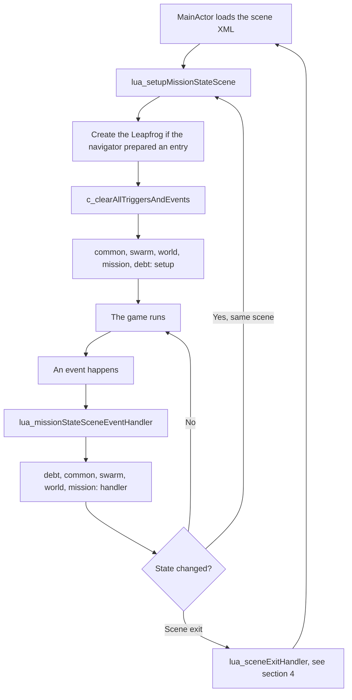
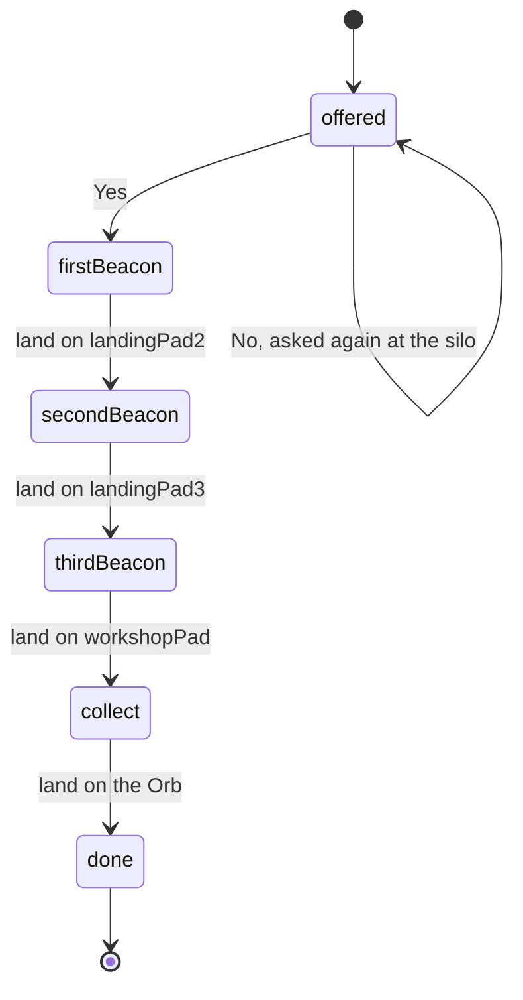
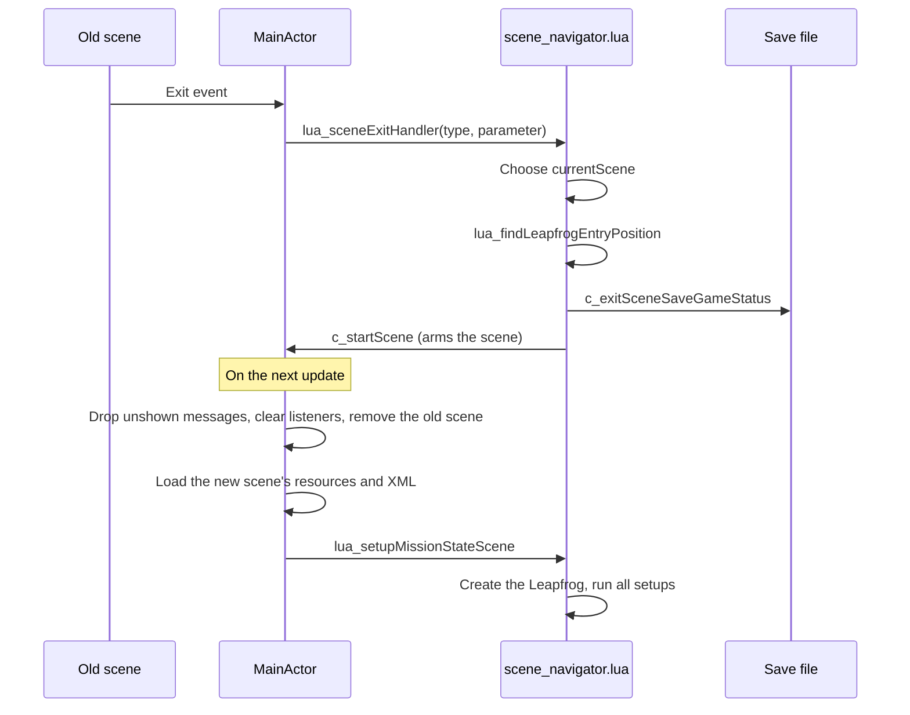

# Leapfrog Lua developer's guide

How the game's story and mission logic is written in Lua: what runs when, how
to build a mission, how events reach your code, and how the game moves between
scenes.

**Status:** draft. Sections 1 to 4 are written. Sections 5 to 7 are planned:

- 5, Recipes: checklists for adding a scene, pad, question, key item or world
- 6, Testing: writing and running mission tester tests
- 7, Reference: every `c_` function, event and object property

The mission tester (`tests/guide.lua`) checks this file. Code marked as coming
from a file must still be in that file, and every `c_` function named here must
exist in `src/luainterface.cpp`.

## 1. How it fits together

The C++ game owns the physics, the scene objects and the display. Lua owns the
story: it decides what a scene contains in the current mission state, and what
happens when something occurs.

| File | Job |
|---|---|
| `src/luainterface.cpp` | Loads the scripts, registers the `c_` functions, passes events to Lua |
| `data/scene_navigator.lua` | Which scene comes next, where the Leapfrog enters, saving at scene exits |
| `data/mission_script.lua` | The master: calls the scripts below, in order, for each setup and event |
| `data/lua/common.lua` | True in every scene: message senders and their colours |
| `data/lua/swarm.lua`, `data/lua/debt.lua` | Shared services: stripper swarms, Bruno's credit |
| `data/lua/worlds/mining.lua` | One world's pads, services and repeatable jobs, also in free play |
| `data/lua/mission_1.lua`, `data/lua/mission_2.lua` | One mission's story, in all its scenes |
| `data/lua/test_starts.lua` | The main menu's test row |

### The two entry points

Almost everything you write runs from one of two functions in a mission or
world script:

- **Scene setup** runs when a scene has been loaded, and again whenever a script
  calls `lua_setupMissionStateScene()`. It builds what this state needs.
- **The event handler** runs each time something the scripts listen to happens.
  It decides what the event means, usually by moving to a new state.



Every script gets every event. A world or mission handler must therefore check
`eventId`, `actorName` and, where it matters, `currentScene` and `currentState`.

### Globals you will use

| Global | Meaning |
|---|---|
| `currentScene` | File name of the scene, e.g. `"home_scene.xml"` |
| `currentSceneType` | 0 landing, 1 deep space, 2 orbit, 3 hyperspace |
| `currentMission` | Mission number, 0 means free play |
| `currentState` | The mission's state, one number |
| `newGameStarting` | True during the very first setup of a new game |
| `lfDefined` | False until the Leapfrog has been created in this scene |
| `useInitialLfPos` | True when the scripts choose the Leapfrog's start position, false when the navigator's `nextLf...` values apply |

### Rules for all scripts

- Use `listen(actorName, eventId)`, not `c_registerEventHandler`. When two
  scripts want the same event, `listen` registers it once and each handler is
  still called once.
- Only `mission_script.lua` calls `c_clearAllTriggersAndEvents`.
- Declare states in a `State` table and refer to them by name. The number is
  what gets saved, so don't renumber a state that saved games may hold.
- Question ids: missions 1 to 99, worlds 100 to 999, common 1000 and up.
- Don't call a `c_` function at the top level of a script file. The scripts are
  loaded before the `c_` functions are registered, so only code inside functions
  can use them.

## 2. Worked example: the dark beacons

`data/lua/mission_2.lua` is a complete small mission, and
`mission_tester/tests/mission2_beacons.lua` plays it. Bruno pays the pilot to
relight three dead beacons in the home scene, one at a time, and to collect the
money at the Orb. Start it from the main menu's test row: **Beacons, job
offered**.

Nothing in the story leads to this mission yet.

### Step 1: plan the states

Only `currentState` is saved, so anything the player must not lose needs a state
of its own. That's why the beacons are lit in a fixed order: the state alone then
says which ones are lit. If the player could light them in any order, one number
wouldn't be enough without one state per combination.



<!-- verbatim: data/lua/mission_2.lua -->
```lua
local State = {
   offered      = 10,  -- Bruno has offered the job
   firstBeacon  = 11,  -- relight the first beacon
   secondBeacon = 12,
   thirdBeacon  = 13,
   collect      = 14,  -- all lit, collect the money at the Orb
   done         = 15,
}
mission2.State = State
```

### Step 2: create and register the script

A mission file returns a table with `firstState`,
`setupMissionStateScene` and `missionStateSceneEventHandler`. It may also have
`reentryOutcome`, see section 4.

Three places make it known to the game:

1. **`src/luainterface.cpp`**, so that `require` finds it. This is the only C++
   change, and the game has to be rebuilt:

   <!-- verbatim: src/luainterface.cpp -->
   ```cpp
   preloadModule("lua/mission_2.lua", "mission2");
   ```

2. **`data/mission_script.lua`**, in the `missions` table:

   <!-- verbatim: data/mission_script.lua -->
   ```lua
   local missions = {
      [1] = mission1,
      [2] = mission2,
   }
   ```

3. **`data/lua/test_starts.lua`**, so that you can start it from the menu:

   <!-- verbatim: data/lua/test_starts.lua -->
   ```lua
   { label = "Beacons, job offered", scene = "home_scene.xml",       sceneType = 0, mission = 2, state = S2.offered },
   ```

New Lua files in `data/lua` need no project changes. Xcode includes that folder
as a whole, and Android takes all of `data`. A new XML file directly in `data`
must be added to both Xcode projects.

### Step 3: write the scene setup

Setup is called for every scene the mission passes through, and again at each
state change. It must rebuild the scene from `currentState` alone, because
objects return to their XML values whenever a scene loads. Lit beacons are only
active because this code says so:

<!-- verbatim: data/lua/mission_2.lua -->
```lua
local function setupBeacons()
   for _, beacon in ipairs(beacons) do
      local lit = currentState > beacon.state
      local isNext = currentState == beacon.state

      if lit then
         c_setObjectProperty(beacon.pad, Pad.active, 1)
         c_setObjectMapState(beacon.pad, beacon.body, 1)     -- filled
      else
         c_setObjectProperty(beacon.pad, Pad.active, 0)
         c_setObjectMapState(beacon.pad, beacon.body, isNext and 2 or 0)  -- flashing or hollow
      end

      if isNext then
         c_registerPropertyTrigger(beacon.pad, 0, Pad.lfLanded, "insideRange", 1, 1)
         listen(beacon.pad, "OpTr")
      end
   end
end
```

An inactive pad sends no `LpLL`, so the mission can't listen for a landing in the
usual way. It watches the pad's `lfLanded` property instead, which changes
whether the pad is active or not.

The mission's setup function starts by leaving every scene but its own:

<!-- verbatim: data/lua/mission_2.lua -->
```lua
mission2.setupMissionStateScene = function()

   if currentScene ~= "home_scene.xml" then
      return
   end

   -- The launch site takes the Leapfrog to deep space
   listen("launchSite1", "LsLL")

   setupBeacons()

   if currentState == State.offered then
      listen("siloLandingPad", "LpLL")
      c_addDialogMessage("Three of the old beacons have gone dark. I pay to have them lit.", "Bruno", true, 60, 0)
      c_askQuestion(Question.takeJob, "Will you do it?", "Bruno", "Touch down and let's talk.")

   elseif currentState == State.collect then
      listen("oreLanding", "LpLL")
      c_setObjectMapState("oreLanding", "noName", 2)
      reminderTimer = c_startSceneTimer(reminderTicks)
   end
end
```

The launch site needs that `listen`. Nothing launches until a script reacts to
`LsLL` by setting the site's property 1, so a mission that leaves it out traps
the player in the scene.

### Step 4: write the event handler

A small helper keeps state changes in one place. Calling
`lua_setupMissionStateScene()` clears all triggers and listeners and runs every
setup again, including the world's:

<!-- verbatim: data/lua/mission_2.lua -->
```lua
local function enterState(state)
   currentState = state
   lua_setupMissionStateScene()
end
```

Then the handler sorts the events and calls small named functions:

<!-- verbatim: data/lua/mission_2.lua -->
```lua
mission2.missionStateSceneEventHandler = function(eventId, actorName, parameter1)

   if currentScene ~= "home_scene.xml" then
      return
   end

   if eventId == "LsLL" then
      -- Nothing launches until a script says so (property 1)
      c_setObjectProperty("launchSite1", 1, 0)
   end

   if (eventId == "QsYs" or eventId == "QsNo") and parameter1 == Question.takeJob then
      answerJob(eventId == "QsYs")
   end

   if eventId == "LpLL" and actorName == "siloLandingPad" and currentState == State.offered then
      c_askQuestion(Question.takeJob, "Changed your mind? Will you do it?", "Bruno")
   end

   if eventId == "OpTr" and parameter1 == Pad.lfLanded then
      relight(actorName)
   end

   -- A timeout comes once per timer started since the last clear, so forget
   -- the id as soon as it has been handled
   if eventId == "ScTO" and parameter1 == reminderTimer then
      reminderTimer = -1
      c_addDialogMessage("All three are lit. Come to the Orb for your money.", "Bruno", true, 0, 0)
   end

   if eventId == "LpLL" and actorName == "oreLanding" and currentState == State.collect then
      collectReward()
   end
end
```

Always check `eventId` along with `parameter1`. A timer id and a question id can
easily be the same number.

### Step 5: test it

A test plays the mission in steps and checks what the scripts did. It runs in a
second, so you can try a state change long before flying it:

<!-- verbatim: mission_tester/tests/mission2_beacons.lua -->
```lua
test("mission 2: the beacons are lit in order, each with a landing", function(t)
   local S, Q = start(t)
   acceptJob(t, S, Q)
   t:expectMap("landingPad2", "siloHome", "flashingSlow")

   t:land("landingPad2")
   t:expectState(S.secondBeacon)
   t:expectHud("Beacon lit")
   t:expectProperty("landingPad2", 2, 1)
   t:expectProperty("landingPad2", 4, 2)
   t:expectMap("landingPad2", "siloHome", "filled")
   t:expectMap("landingPad3", "siloHome", "flashingSlow")
   t:takeOff()

   t:land("landingPad3")
   t:expectState(S.thirdBeacon)
end)
```

Add the file to `mission_tester/tests/test_list.lua` and to the `None` items in
`mission_tester.vcxproj`. To run only these tests on the Mac:

```
leapfrog-game/mission_tester/build.sh -- --filter "mission 2"
```

The tester proves the logic, not the flying. Play the mission from the test row
as well.

### Step 6: start and end a mission

No code moves from one mission to the next yet. A mission hands over by setting
the two globals and setting the scene up again. This has been tried in the tester
but not in the game:

```lua
currentMission = 2
currentState = mission2.firstState
lua_setupMissionStateScene()
```

The save at the next scene exit stores the new mission.

The beacons mission ends in `State.done` rather than going to free play, because
free play can't launch yet. See [known gaps](#known-gaps).

## 3. Events and triggers

### Listening

`listen("landingPad2", "LpLL")` asks for one event from one scene object. Handlers
receive `(eventId, actorName, parameter1)`. All listeners go at every clear, which
means at every setup, so register them again in the setup that needs them.

If the object doesn't exist, `c_registerEventHandler` shows an error on the
message display. Property and map calls on a missing object do nothing, silently.
An object spawned during play isn't there yet at the moment it's requested, so
wait a few ticks before listening to it.

### Events you can use

| Event | Sent by | Parameter | Meaning |
|---|---|---|---|
| `LpLL` | Landing pad | 0 | Leapfrog landed, active pads only, once per landing |
| `LpTO` | Landing pad | 0 | Leapfrog took off, active pads only |
| `LsLL` | Launch site | 0 | Leapfrog landed, active sites only |
| `DsDk` | Docking station | 0 | Leapfrog docked, active stations only |
| `DsUd` | Docking station | 0 | Leapfrog undocked, active stations only |
| `BrBR` | Breakable object | 0 | It broke |
| `ExEX` | Explosive object | 0 | It exploded |
| `PuPU` | Pickup | 0 | It was picked up |
| `LfSt` | `leapfrog1` | Property taken: 5 ammo, 6 shield, 7 fuel, 8 credits, or 0 for nothing | A stripper took something |
| `OpTr` | Any object | Property id | A property trigger fired |
| `ScTO` | The scene | Timer id | A scene timer ran out |
| `QsYs`, `QsNo` | The scene | Question id | A question was answered |

`ScTO`, `QsYs` and `QsNo` need no `listen`.

### Property triggers

A trigger sends `OpTr` when an object's property is set to a value in a range. It
takes two calls. The second argument of the first call doesn't reach Lua, so pass 0:

<!-- verbatim: data/lua/mission_2.lua -->
```lua
         c_registerPropertyTrigger(beacon.pad, 0, Pad.lfLanded, "insideRange", 1, 1)
         listen(beacon.pad, "OpTr")
```

The type is `"insideRange"` or `"outsideRange"`, and the range is inclusive.

A trigger tests each new value, not the crossing of a limit. So it fires every
time the property is set while it's in range, and not at all if the value is
already in range and never set again. Either guard your handler with a state or
expect repeats. `debt.lua` watches credits this way, with its `owing` flag as the
guard.

### Timers

`c_startSceneTimer(ticks)` returns an id, and `ScTO` arrives with that id when it
runs out. There are 60 ticks a second of game time, and timers stop while the game
is paused. A timer can't be cancelled, and it ends with the scene.

Three things catch people out:

- **A timeout arrives once per timer started since the last clear.** With three
  timers started, each timeout reaches your handler three times. Set your stored
  id to -1 as soon as you've handled it, as the beacons mission does.
- **A state change disconnects running timers.** `lua_setupMissionStateScene()`
  removes the listener, but the timer keeps counting. Its timeout is lost, unless
  another timer started after the clear has added a listener, in which case it
  arrives with the old id. Start timers in the setup, as the beacons mission does,
  rather than just before a state change.
- **Timers aren't saved.** A state that needs one must start it in its setup, so
  that it also runs after a reload.

### Questions

`c_askQuestion(id, text, sender, flightText)` asks a yes/no question. It's only
answered with the Leapfrog standing on a pad or launch site, and one asked in
flight waits for the landing. `flightText` is added if it's still in flight when
the question's turn comes. The booster button becomes Yes and the fire button No.

Questions are queued, so asking one that's already waiting does nothing. An
unanswered question is dropped when the scene ends. Remember that if you keep a
flag for it, as mission 1 does with `offerPending`.

### Dialog and the HUD

`c_addDialogMessage(message, sender, leftSide, preDelay, postDelay)` queues a line.
Others speak on the left, the pilot on the right, and delays are in frames.
`c_hudLog(text, critical)` writes one line in the event log.

**Lines not yet shown when a scene ends are dropped.** That includes anything
said during a scene exit. To say something on arrival, store it and say it in the
next setup, as `mining.lua` does with `arrivalLines`.

## 4. Scene transitions

### What leaves a scene

| Leaving | How it happens | Lua gets |
|---|---|---|
| Landing | A script sets the launch site's property 1, the launch runs, the screen fades out | `lua_sceneExitHandler(0, 1)` |
| Deep space | The Leapfrog stays 2.5 s in a corner's transit field | `lua_sceneExitHandler(1, corner)`: 1 upper right, 2 upper left, 3 lower right, 4 lower left |
| Orbit | Re-entry ends | `lua_sceneExitHandler(2, result)`: site index 0 and up, -1 no sites, -2 burned up, -3 bounced |



### What the navigator does

`lua_sceneExitHandler` chooses the next scene and saves. This is the branch for
leaving deep space:

<!-- verbatim: data/scene_navigator.lua -->
```lua
      if currentScene == "deep_space_scene.xml" then
         if exitParameter == 3 then
            currentScene = "orbit_scene.xml"
            currentSceneType = 2
            
            lua_findLeapfrogEntryPosition(exitSceneType, exitParameter)
            c_exitSceneSaveGameStatus(currentScene, currentMission, currentState, currentSceneType, oldScene, exitSceneType, exitParameter)
         end
      end
```

`lua_findLeapfrogEntryPosition` then fills in where the Leapfrog appears:

<!-- verbatim: data/scene_navigator.lua -->
```lua
   elseif exitSceneType == 1 and exitParameter == 3 then
      -- We are leaving deep space scene in lower right corner, to orbit scene
      if currentScene == "orbit_scene.xml" then
         nextLfFile = "leapfrog_deep_space.xml"
         nextLfPosX = -8
         nextLfPosY = 18
         nextLfMode = 1
         useInitialLfPos = false
         lfDefined = false
      end
```

Setting `lfDefined = false` is what makes the next setup create the Leapfrog. An
exit with no matching branch leaves it true, and the new scene has no Leapfrog.

### Who creates the Leapfrog

| Arriving | Created by |
|---|---|
| After a scene exit | `lua_setupMissionStateScene`, from the `nextLf...` values |
| New game or test start at home | `mining.lua`, because `useInitialLfPos` is true |
| Start in any other scene without a `from` | The mission's setup, which must do it itself |

### What is saved

The game saves at scene exits, and when a mission's first scene starts. The save
holds the scene, mission, state, exit, the Leapfrog's resources and upgrade levels,
and the key items.

Everything else is rebuilt from XML and setup on arrival: Lua variables, pad
settings, broken asteroids, timers and open questions. After a load, the game
restores the status, calls `lua_forceCurrentScene` and
`lua_findLeapfrogEntryPosition`, and starts the saved scene, so the same setups run
as in a normal arrival.

### Adding a new exit

1. In `lua_sceneExitHandler`, add a branch that sets `currentScene` and
   `currentSceneType`, and calls `lua_findLeapfrogEntryPosition` and
   `c_exitSceneSaveGameStatus`.
2. In `lua_findLeapfrogEntryPosition`, add the matching entry. It must set
   `nextLfFile`, `nextLfPosX`, `nextLfPosY`, `nextLfMode`,
   `useInitialLfPos = false` and `lfDefined = false`.
3. For a new scene, add it to `sceneWorld` in `mission_script.lua` and to
   `data/scene_resources.xml`, and add its XML file to both Xcode projects.
4. For a new landing site, set `scene=` on its `<landingSite>` and add the scene
   to `orbitArrivals` in `scene_navigator.lua`.
5. Add a line to `lua/test_starts.lua`. The tester then checks the entry exists.

### Re-entry outcomes

When the orbit scene exits, `lua_reentryOutcome` calls the world's and then the
mission's `reentryOutcome(r)`, before the next scene is chosen and saved. So a fee
charged there is in the save. `r` has `outcome`, `siteIndex`, `siteName`,
`siteScene`, `distance` and `burn`. Anything to say goes in the next setup, for
the reason given under [Dialog and the HUD](#dialog-and-the-hud).

### Known gaps

- **Three deep space corners are unfinished.** Only the lower right corner is
  handled. In the others the scene reloads with no Leapfrog and nothing saved,
  because no entry position is set.
- **Free play can't launch.** Only missions react to `LsLL`, so with
  `currentMission == 0` the launch site does nothing.
- **There is no ground-to-ground exit.** The landing scene's only exit goes to deep
  space, so moving between landing scenes, as the cave missions will, needs a new
  exit.
- **Hyperspace isn't implemented.** Scene type 3 has no exit handling.
- **Quitting early loses progress.** Quitting at home before leaving the scene and
  continuing starts the mission over. The tester lists this as a known issue.
